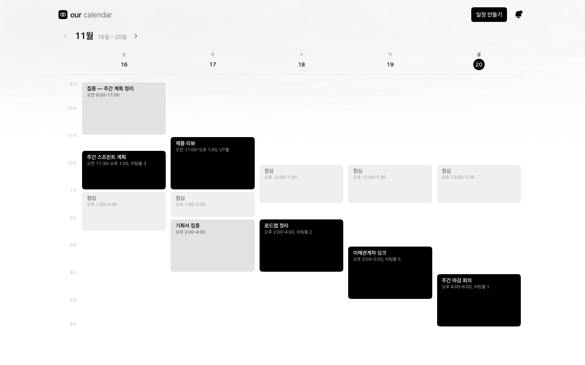
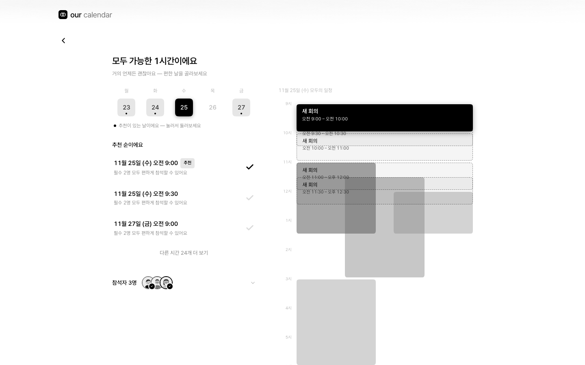

# our calendar

> 알아서 맞춰주는 캘린더. 혼자일 때는 내 캘린더이고, 참석자를 더하는 순간 우리의 캘린더가 됩니다.

실제로 동작하는 웹앱입니다. PC와 모바일을 모두 대응하고, 날짜는 언제 열어도 오늘 기준으로 움직입니다.

```bash
npm install
npm run dev        # http://localhost:3000
```

<p>
  
</p>

## 문제 정의 · 좋은 회의는 좋은 시간에서 시작된다

회의를 잡을 때마다 같은 대화가 반복됐습니다. "저는 그때 어려워요",
"그 시간보다는 이 시간이 나아요." 조율은 늘 메신저를 오가는 눈치 게임이었고,
저는 이걸 어떻게 풀 수 있을까를 오래 생각했습니다.

조율의 전제는 참석자 모두의 일정을 아는 것입니다. 하지만 일정을 안다고 끝나지
않습니다. 캘린더의 빈 칸이 곧 좋은 시간은 아니기 때문입니다. 점심 직후는 누구나
힘들고, 어떤 사람은 앞뒤 일정 때문에 30분밖에 낼 수 없습니다. 기존 도구는
"가능한 시간"을 계산해줄 뿐, "좋은 상태로 모일 수 있는 시간"은 묻지 않습니다.

여기서 회의의 목적으로 돌아갔습니다. 회의는 모이는 것 자체가 아니라
**함께 좋은 방향으로 나아가기 위한 일**입니다. 그렇다면 시간 선택은 일정 관리가
아니라 회의 품질의 문제입니다. 모두가 조금 더 좋은 상태로 앉아야 좋은 결과가
나옵니다. 꼭 참석할 사람들의 시간이 축이 되어야 하고, 선택 참석자는 잠깐이라도
함께하는 것이 의미 있습니다. 안건의 흐름을 공유하는 30분이, 아예 못 오는 것보다
회의를 좋게 만들기 때문입니다.

그래서 이 제품은 조율 도구가 아니라 **캘린더**입니다. 일정은 캘린더에서 태어납니다.
혼자면 내 일정이 되고, 참석자를 더하는 순간 우리의 일이 됩니다. 그 순간부터
캘린더가 참석자들의 하루를 대신 읽고, 배려가 담긴 시간을 이유와 함께 추천합니다.

## 경험을 설계한 방식

**이유가 신뢰를 만듭니다.** 모든 추천에는 "필수 2명 모두 편하게 참석할 수 있어요",
"박준호님은 뒤 30분만 함께할 수 있어요"처럼 사람 이름과 근거가 붙습니다.
시스템이 왜 이 시간을 골랐는지 알 수 있어야, 그 시간을 믿고 보낼 수 있습니다.

**상황이 다르면 화면의 문법도 다릅니다.** 모두 가능한 날은 달력과 추천이 나란히 서고,
전부 조금씩 아쉬운 날은 "그나마 나은 순"이라고 정직하게 말을 바꿉니다.
후보가 아예 없으면 없는 것을 있는 척 그리지 않습니다. 달력을 치우고
"기한을 다음 주까지로 미뤄요" 같은 다음 수를 제안하는 화면으로 바뀝니다.

**백지 선택을 시키지 않습니다.** 시간 찾기에 들어서면 1위 후보가 이미 골라져 있습니다.
사용자는 0에서 고르는 게 아니라, 좋은 기본값에서 출발해 취향만 조정합니다.
장소만은 예외로 비워뒀습니다. 회의실은 조직마다 사정이 달라서, 추천 배지만 달고 선택은 맡깁니다.

**꼭 참석할 사람을 시스템이 반쪽 참석시키지 않습니다.** 부분 참석은 후보가 없을 때
"한도윤님이 일부만 함께하면 돼요"라는 허락제 제안으로만 등장합니다. 수락하면 초대장에
"뒤 30분만 함께해도 충분해요" 문구와 안건 배치 추천, 퇴장 5분 전 알림까지 함께 챙깁니다.

**받는 사람의 경험까지가 조율입니다.** 보내기 전에 "참석자에게는 이렇게 보여요"로
상대 화면을 미리 보고, 받은 사람의 초대장엔 자기 이야기가 첫 줄로 옵니다.
거절도 존중받습니다. "어려워요"를 누르면 사유와 함께 정중하게 전달되고,
주최자에겐 응답이 토스트와 알림으로 돌아옵니다.

<p>
  
  
</p>

## 이렇게 걸어보세요

홈에서 **일정 만들기**로 시작합니다. 참석자를 더하지 않으면 그대로 내 캘린더에 저장됩니다.
참석자를 더하면 추천 중 하나를 골라 초대를 보낼 수 있고, 홈으로 돌아오면 잠시 뒤
동료들의 응답이 도착합니다. 홈 캘린더에 점선으로 서 있는 **받은 초대**를 열면
이번에는 받는 입장이 됩니다.

참석자와 조건이 URL에 담겨 있어 어떤 장면이든 그대로 다시 열 수 있습니다.

| 장면 | 주소 (`http://localhost:3000` 뒤에 붙입니다) |
| --- | --- |
| 혼자면 바로 캘린더에 · 내 일정 만들기 | `/?p=ichan.r&d=60&dl=nw&s=setup` |
| 6명(꼭 참석 4, 선택 2), 1시간, 다음 주까지 | `/?p=ichan.r,junho.r,seoyeon.r,minsu.r,haneul.o,sehun.o&d=60&dl=nw&s=setup` |
| 모두 가능한 시간이 있는 날 | `/?p=ichan.r,junho.o,seoyeon.r&d=60&dl=nw&s=find` |
| 전부 조금씩 아쉬운 날 · "그나마 나은 순" | `/?p=ichan.r,junho.r,seoyeon.r,sehun.r,jiwoo.r,daon.r&d=60&dl=nw&s=find` |
| 모두가 편한 시간이 없는 날 · 다음 수 제안 | `/?p=ichan.r,junho.r,seoyeon.r,sehun.r,jiwoo.r,daon.r&d=60&dl=tw&s=find` |
| 초대를 받는 입장 | `/?s=invite` |

## 디자인 · 검정과 흰색 위에, 색은 정보에만

바탕은 검정과 흰색입니다. 버튼, 선택, 글자는 무채색으로 두고 색은 정보를 구분할 때만 씁니다.

- **일정 종류는 색으로 구분합니다.** 회의는 보라, 집중 시간은 초록, 점심은 호박, 휴가는 올리브, 외근은 로즈입니다.
  옅은 바탕에 같은 계열의 짙은 글자를 올려, 제목은 대비 4.5:1 이상을 지킵니다.
- **사람도 색으로 구분합니다.** 시간 찾기의 타임라인에서 누가 언제 바쁜지를 사람마다 다른 색으로 보여 줍니다.
- **파란 계열은 쓰지 않습니다.** 주요 행동과 선택은 순수한 검정 면입니다.
- 경고는 호박, 새 알림은 빨간 점입니다.
- 글자는 가볍게 둡니다(굵기 300~560). 라틴 글자와 숫자는 Overused Grotesk, 한글은 Pretendard입니다. 무게는 글자가 아니라 검정 면이 집니다.
- 로고는 심벌 없이 글자만 씁니다. `our`는 진하게, `calendar`는 옅게 씁니다.

토큰은 `src/app/styles/globals.css`, 일정 종류별 색은 `src/entities/event/model/kind-style.ts`에 있습니다.

## 구조 · Feature-Sliced Design 2.1

```
app/                      Next.js 라우팅 폴더. 구현 없이 src/app을 다시 내보낸다
pages/                    일부러 비워 둔 폴더 (pages/README.md 참고)
src/
  app/                    레이아웃, 전역 스타일, 스텝 라우터
  pages/                  화면 하나가 슬라이스 하나
    home/                 홈 캘린더
    setup/                일정 만들기 (참석자, 조건)
    find-time/            시간 찾기 (스캔, 추천, 모두의 일정)
    confirm/              확정 전 마지막 조정
    done/                 완료
    invite/               받은 초대, 보낼 초대 미리 보기
    notifications/        알림 목록
  widgets/
    notification-center/  알림 벨, 토스트, 알림 저장소
  features/
    schedule-meeting/     일정 잡기 흐름과 추천 엔진
  entities/
    member/  event/  room/  slot/
  shared/
    ui/  lib/  config/
```

지킨 규칙은 다음과 같습니다.

- **화면이 먼저입니다.** 한 화면에서만 쓰는 코드는 그 화면 슬라이스에 둡니다.
  두 화면 이상에서 쓰일 때만 아래 레이어로 내립니다. 알림은 홈, 알림 목록, 스텝 라우터가
  함께 써서 위젯이 됐고, 일정 잡기 흐름은 모든 화면이 써서 피처가 됐습니다.
- **위에서 아래로만 가져옵니다.** `app → pages → widgets → features → entities → shared`
  방향으로만 import합니다.
- **슬라이스는 공개 API로만 만납니다.** 다른 슬라이스의 파일을 직접 가져오지 않고
  `index.ts`가 내보낸 것만 씁니다. 구성원이 일정 타입을 참조하는 것처럼 엔티티끼리 만나야
  할 때는 `@x` 표기를 씁니다(`entities/event/@x/member.ts`).
- **추천 엔진은 순수 함수입니다.** `features/schedule-meeting/lib`의 점수 계산, 부분 참석,
  조건 완화는 React를 가져오지 않고, 화면 없이 테스트합니다.

구조는 FSD 공식 린터로 검사합니다.

```bash
npm run lint:fsd    # steiger
npm run typecheck   # tsc --noEmit
npm test            # vitest
npm run build
```

## 브랜치 · git-flow

- `main` 배포 기준. 릴리스마다 태그를 붙입니다.
- `develop` 다음 릴리스를 모으는 기준 브랜치.
- `feature/*` 기능 단위 작업. `develop`에서 갈라져 `develop`으로 병합합니다(`--no-ff`).
- `release/*` 릴리스 준비. `main`과 `develop` 양쪽으로 병합합니다.
- `hotfix/*` 배포된 버전의 긴급 수정. `main`에서 갈라집니다.

커밋 메시지는 `type(scope): 내용` 형식입니다.

## 기술

Next.js 16(App Router), React 19, TypeScript, Tailwind CSS 4, Motion, Vitest, Steiger.

글꼴: [Overused Grotesk](https://github.com/RandomMaerks/Overused-Grotesk)(SIL OFL 1.1, 라이선스 전문은 `src/app/fonts/OverusedGrotesk-OFL.txt`), [Pretendard](https://github.com/orioncactus/pretendard)(SIL OFL 1.1).
