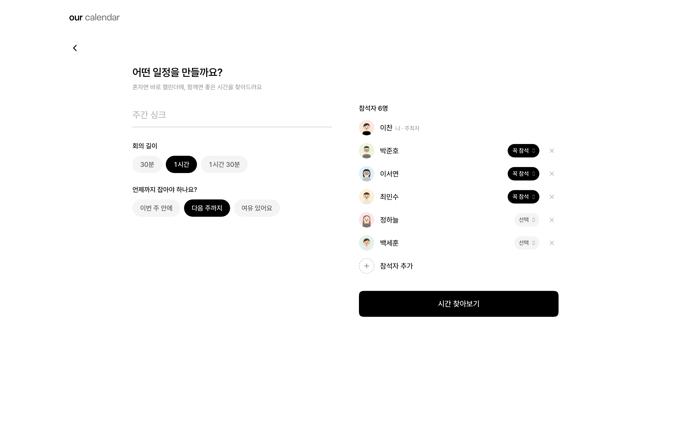
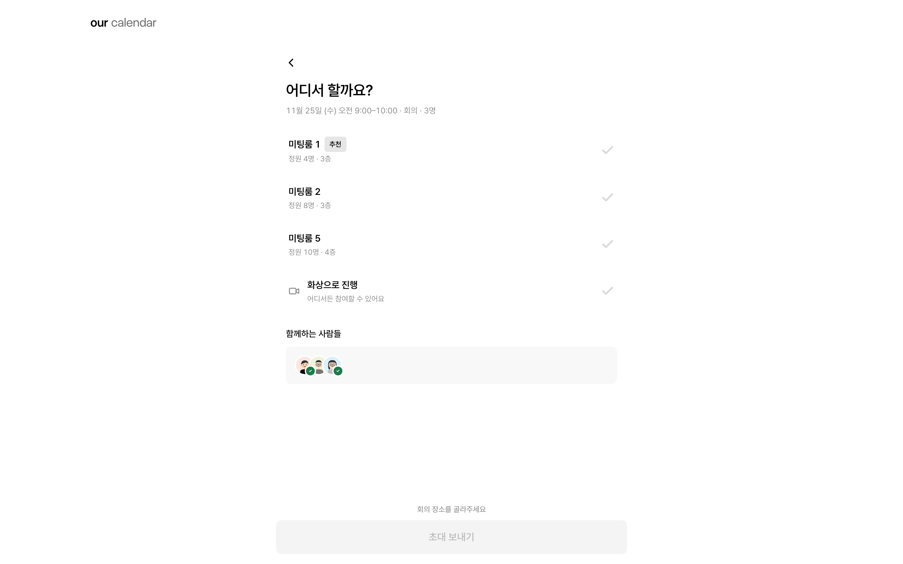
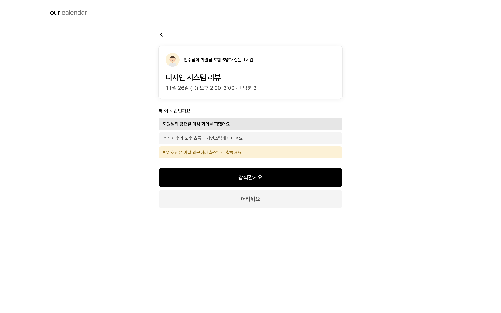
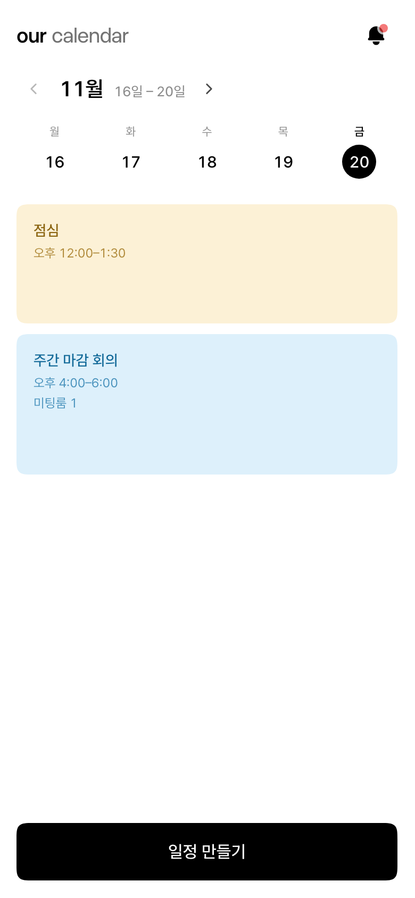
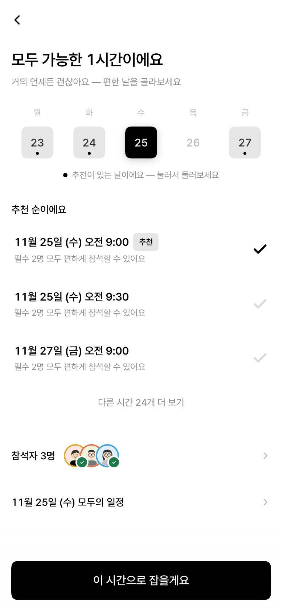

# our calendar

> 알아서 맞춰주는 캘린더. 혼자일 때는 내 캘린더이고, 참석자를 더하는 순간 우리의 캘린더가 됩니다.

<p>
  
</p>

회의 하나를 잡을 때 동료들의 하루를 먼저 읽고, 모두가 괜찮은 시간을 이유와 함께 추천하는 캘린더입니다.
기획, 디자인, 개발을 혼자 했습니다.

- **혼자 쓰면 내 캘린더입니다.** 일정을 만들면 그대로 내 캘린더에 들어갑니다.
- **참석자를 더하면 우리의 캘린더입니다.** 참석자들의 일정을 읽고 좋은 시간을 순서대로 추천합니다.
- **추천에는 이유가 붙습니다.** "필수 2명 모두 편하게 참석할 수 있어요"처럼 사람과 근거를 함께 보여 줍니다.
- **PC와 모바일을 모두 대응합니다.** 날짜는 언제 열어도 오늘 기준으로 움직입니다.

```bash
npm install
npm run dev        # http://localhost:3000
```

## 목차

1. [문제 정의](#문제-정의)
2. [설계 원칙](#설계-원칙)
3. [화면 흐름](#화면-흐름)
4. [추천이 만들어지는 방식](#추천이-만들어지는-방식)
5. [디자인](#디자인)
6. [구조](#구조)
7. [검증](#검증)
8. [AI와 함께 만든 방식](#ai와-함께-만든-방식)
9. [한계와 다음 단계](#한계와-다음-단계)
10. [브랜치와 커밋](#브랜치와-커밋)
11. [기술과 글꼴](#기술과-글꼴)

## 문제 정의

**좋은 회의는 좋은 시간에서 시작됩니다.**

회의를 잡을 때마다 같은 대화가 반복됐습니다. "저는 그때 어려워요",
"그 시간보다는 이 시간이 나아요." 조율은 늘 메신저를 오가는 눈치 게임이었고,
저는 이걸 어떻게 풀 수 있을까를 오래 생각했습니다.

조율의 전제는 참석자 모두의 일정을 아는 것입니다. 하지만 일정을 안다고 끝나지
않습니다. 캘린더의 빈 칸이 곧 좋은 시간은 아니기 때문입니다. 점심 직후는 누구나
힘들고, 어떤 사람은 앞뒤 일정 때문에 30분밖에 낼 수 없습니다. 기존 도구는
"가능한 시간"을 계산해줄 뿐, "좋은 상태로 모일 수 있는 시간"은 묻지 않습니다.

여기서 회의의 목적으로 돌아갔습니다. 회의는 모이는 것 자체가 아니라
**함께 좋은 방향으로 나아가기 위한 일**입니다. 그렇다면 시간 선택은 일정 관리가
아니라 회의 품질의 문제입니다. 모두가 조금 더 좋은 상태로 앉아야 좋은 결과가
나옵니다. 꼭 참석할 사람들의 시간이 축이 되어야 하고, 선택 참석자는 잠깐이라도
함께하는 것이 의미 있습니다. 안건의 흐름을 공유하는 30분이, 아예 못 오는 것보다
회의를 좋게 만들기 때문입니다.

그래서 이 제품은 조율 도구가 아니라 **캘린더**입니다. 일정은 캘린더에서 태어납니다.
혼자면 내 일정이 되고, 참석자를 더하는 순간 우리의 일이 됩니다. 그 순간부터
캘린더가 참석자들의 하루를 대신 읽고, 배려가 담긴 시간을 이유와 함께 추천합니다.

## 설계 원칙

**이유가 신뢰를 만듭니다.** 모든 추천에는 "필수 2명 모두 편하게 참석할 수 있어요",
"박준호님은 뒤 30분만 함께할 수 있어요"처럼 사람 이름과 근거가 붙습니다.
시스템이 왜 이 시간을 골랐는지 알 수 있어야, 그 시간을 믿고 보낼 수 있습니다.

**상황이 다르면 화면의 문법도 다릅니다.** 모두 가능한 날은 달력과 추천이 나란히 서고,
전부 조금씩 아쉬운 날은 "그나마 나은 순"이라고 정직하게 말을 바꿉니다.
후보가 아예 없으면 없는 것을 있는 척 그리지 않습니다. 달력을 치우고
"기한을 다음 주까지로 미뤄요" 같은 다음 수를 제안하는 화면으로 바뀝니다.

**백지 선택을 시키지 않습니다.** 시간 찾기에 들어서면 1위 후보가 이미 골라져 있습니다.
사용자는 0에서 고르는 게 아니라, 좋은 기본값에서 출발해 취향만 조정합니다.
장소만은 예외로 비워뒀습니다. 회의실은 조직마다 사정이 달라서, 추천 배지만 달고 선택은 맡깁니다.

**꼭 참석할 사람을 시스템이 반쪽 참석시키지 않습니다.** 부분 참석은 후보가 없을 때
"한도윤님이 일부만 함께하면 돼요"라는 허락제 제안으로만 등장합니다. 수락하면 초대장에
"뒤 30분만 함께해도 충분해요" 문구와 안건 배치 추천, 퇴장 5분 전 알림까지 함께 챙깁니다.

**받는 사람의 경험까지가 조율입니다.** 보내기 전에 "참석자에게는 이렇게 보여요"로
상대 화면을 미리 보고, 받은 사람의 초대장엔 자기 이야기가 첫 줄로 옵니다.
거절도 존중받습니다. "어려워요"를 누르면 사유와 함께 정중하게 전달되고,
주최자에겐 응답이 토스트와 알림으로 돌아옵니다.

## 화면 흐름

| 단계 | 화면 | 하는 일 |
| --- | --- | --- |
| 1 | 홈 | 내 주간 캘린더를 봅니다. 받은 초대는 캘린더 안에 점선 블록으로 서 있습니다. |
| 2 | 일정 만들기 | 제목, 길이, 기한을 정합니다. 참석자를 더하지 않으면 그대로 내 캘린더에 저장됩니다. |
| 3 | 시간 찾기 | 참석자들의 일정을 읽은 뒤 추천을 순서대로 보여 줍니다. 오른쪽에는 그날 모두의 일정이 겹쳐 보입니다. |
| 4 | 확정 | 회의 장소를 고르고, 필요하면 "10분 늦게 시작" 같은 조정을 더합니다. |
| 5 | 완료 | 초대를 보내고, 함께 챙긴 것을 정리해 보여 줍니다. 홈으로 돌아오면 응답이 도착합니다. |
| 별도 | 받은 초대 | 왜 이 시간인지 이유를 읽고 참석 또는 어려움을 응답합니다. |

<p>
  
  
</p>
<p>
  
  
</p>

모바일은 같은 정보를 기기에 맞는 문법으로 다시 설계했습니다. PC에서 누른 자리 곁에 열리던
선택지가 모바일에서는 바텀시트로 올라오고, 주간 그리드는 요일 칩과 하루 목록으로 바뀝니다.

<p>
  
  
</p>

참석자와 조건이 주소에 담겨 있어 어떤 장면이든 그대로 다시 열 수 있습니다.
아래 주소를 `http://localhost:3000` 뒤에 붙입니다.

| 장면 | 주소 |
| --- | --- |
| 혼자면 바로 캘린더에 | `/?p=ichan.r&d=60&dl=nw&s=setup` |
| 6명(꼭 참석 4, 선택 2), 1시간, 다음 주까지 | `/?p=ichan.r,junho.r,seoyeon.r,minsu.r,haneul.o,sehun.o&d=60&dl=nw&s=setup` |
| 모두 가능한 시간이 있는 날 | `/?p=ichan.r,junho.o,seoyeon.r&d=60&dl=nw&s=find` |
| 전부 조금씩 아쉬운 날, "그나마 나은 순" | `/?p=ichan.r,junho.r,seoyeon.r,sehun.r,jiwoo.r,daon.r&d=60&dl=nw&s=find` |
| 모두가 편한 시간이 없는 날, 다음 수 제안 | `/?p=ichan.r,junho.r,seoyeon.r,sehun.r,jiwoo.r,daon.r&d=60&dl=tw&s=find` |
| 초대를 받는 입장 | `/?s=invite` |

## 추천이 만들어지는 방식

추천 엔진은 `src/features/schedule-meeting/lib`에 있는 순수 함수입니다. React를 가져오지 않고,
같은 입력에는 항상 같은 결과를 냅니다.

**1. 후보를 만듭니다.** 꼭 참석할 사람들의 근무 시간이 겹치는 구간을 30분 간격으로 훑습니다.

**2. 안 되는 시간을 걸러 냅니다.** 꼭 참석할 사람이 회의, 외근, 휴가와 겹치는 시간은 후보에서 뺍니다.
집중 시간과 점심은 막지 않습니다. 옮길 수 있는 일정이기 때문입니다. 대신 점수에서 깎습니다.

**3. 남은 후보에 점수를 매깁니다.** 좋은 상태로 모일 수 있는지를 봅니다.

| 상황 | 점수 |
| --- | --- |
| 선택 참석자가 온전히 참석할 수 있음 | +10 |
| 선택 참석자가 일부만 참석할 수 있음 | +7 |
| 누군가의 점심 직전 30분 안에 끝남 | +4 |
| 선택 참석자가 참석할 수 없음 | −4 |
| 근무 시간이 끝나기 직전까지 이어짐 | −4 |
| 누군가의 집중 시간과 겹침 | −5 |
| 앞뒤 일정과 15분 안으로 붙음 | −6 |
| 비어 있는 회의실이 없음 | −7 |
| 누군가 그날 외근이 있음 | −8 |
| 점심 시간대에 한 시간의 여유도 남기지 않음 | −8 |
| 누군가의 점심이 끝나고 30분 안에 시작함 | −12 |

부분 참석(+7)과 불참(−4)의 차이를 11점으로 둔 것은 의도한 값입니다. "30분이라도 함께"가
"아예 못 옴"보다 항상 앞서야 한다는 원칙을 점수로 고정했습니다.
점심 시간은 정해 두지 않았습니다. 사람마다 일정에서 평소 점심 시간대를 읽어 그 사람 기준으로 봅니다.

**4. 부분 참석을 판정합니다.** 선택 참석자가 회의의 앞이나 뒤 절반 이상을 이어서 함께할 수 있으면
부분 참석으로 봅니다. 가운데만 빠지는 경우는 인정하지 않습니다.

**5. 후보가 없으면 풀 방법을 시뮬레이션합니다.** 보여 줄 후보가 없거나 전부 무리가 있는 시간이면,
아래 네 가지를 실제로 돌려 보고 시간이 열리는 것만 "수요일 10시가 열려요, 후보 3개"처럼 숫자와 함께 제안합니다.

- 기한을 한 단계 미루기
- 회의를 짧게 하기
- 꼭 참석을 선택 참석으로 바꾸기
- 꼭 참석할 사람의 부분 참석을 허락받기

이때 누구의 어떤 일정이 걸림돌인지도 지목합니다. 꼭 참석할 사람을 한 명씩 빼고 다시 계산해,
후보가 가장 많이 늘어나는 사람과 그 사람의 일정을 찾습니다. 주최자는 대상에서 뺍니다.

**6. 사람의 패턴을 읽습니다.** 참석자의 일정에서 외근이 잦은 요일, 반복되는 회의, 점심 시간대를 뽑아
참석자 선택 화면의 안내 문장과 점수 계산에 같이 씁니다. 한 번 뽑은 결과를 여러 곳이 함께 써서
화면마다 말이 달라지지 않습니다.

## 디자인

바탕은 검정과 흰색입니다. 버튼, 선택, 글자는 무채색으로 두고 색은 정보를 구분할 때만 씁니다.

| 일정 종류 | 색 |
| --- | --- |
| 회의 | 하늘 |
| 집중 시간 | 초록 |
| 점심 | 노랑 |
| 휴가 | 스톤 |
| 외근 | 코랄 |

- **일정 종류와 사람은 색으로 구분합니다.** 옅은 바탕에 같은 계열의 짙은 글자를 올려,
  제목은 바탕 대비 4.5:1 이상을 지킵니다. 시간 찾기의 타임라인은 누가 언제 바쁜지를 사람마다 다른 색으로 보여 줍니다.
- **주요 행동과 선택은 순수한 검정 면입니다.** 화면에서 가장 진한 것이 지금 누를 것입니다.
- **경고는 노랑, 새 알림은 빨간 점입니다.**
- **글자는 가볍게 둡니다.** 굵기 단계를 통째로 한 칸씩 가볍게 잡았습니다(300~560).
- **로고는 심벌 없이 글자만 씁니다.** `our`는 진하게, `calendar`는 옅게 씁니다.
- **브라우저 탭과 홈 화면의 아이콘은 겹친 두 원입니다.** 검은 타일 위에 흰 원 두 개가 겹쳐 있습니다.
  나의 시간과 너의 시간이 겹치는 곳이 우리의 시간이라는 뜻입니다.

처음에는 전부 무채색으로 만들었습니다. 캘린더가 어두워지고 일정 종류가 읽히지 않아 종류별 색을 되살렸고,
그 뒤 채도를 두 번 고쳐 지금의 값이 됐습니다. 검정 버튼과 부딪히지 않으면서 색이 분명히 읽히는 지점을 찾는 과정이었습니다.

토큰은 `src/app/styles/globals.css`, 일정 종류별 색은 `src/entities/event/model/kind-style.ts`에 있습니다.

## 구조

Feature-Sliced Design 2.1을 따릅니다.

```
app/                      Next.js 라우팅 폴더. 구현 없이 src/app을 다시 내보낸다
pages/                    일부러 비워 둔 폴더 (pages/README.md 참고)
src/
  app/                    레이아웃, 전역 스타일, 글꼴, 스텝 라우터
  pages/                  화면 하나가 슬라이스 하나
    home/                 홈 캘린더
    setup/                일정 만들기 (참석자, 조건)
    find-time/            시간 찾기 (스캔, 추천, 모두의 일정)
    confirm/              확정 전 마지막 조정
    done/                 완료
    invite/               받은 초대, 보낼 초대 미리 보기
    notifications/        알림 목록
  widgets/
    notification-center/  알림 벨, 토스트, 알림 저장소
  features/
    schedule-meeting/     일정 잡기 흐름과 추천 엔진
  entities/
    member/  event/  room/  slot/
  shared/
    ui/  lib/  config/
```

- **화면이 먼저입니다.** 한 화면에서만 쓰는 코드는 그 화면 슬라이스에 둡니다.
  두 화면 이상에서 쓰일 때만 아래 레이어로 내립니다. 알림은 홈, 알림 목록, 스텝 라우터가
  함께 써서 위젯이 됐고, 일정 잡기 흐름은 모든 화면이 써서 피처가 됐습니다.
- **위에서 아래로만 가져옵니다.** `app → pages → widgets → features → entities → shared`
  방향으로만 import합니다.
- **슬라이스는 공개 API로만 만납니다.** 다른 슬라이스의 파일을 직접 가져오지 않고
  `index.ts`가 내보낸 것만 씁니다. 구성원이 일정 타입을 참조하는 것처럼 엔티티끼리 만나야
  할 때는 `@x` 표기를 씁니다(`entities/event/@x/member.ts`).
- **화면 전환은 주소가 기억합니다.** 한 페이지 안에서 단계를 바꾸는 스텝 라우터(`src/app/routes`)가
  상태를 주소에 적어, 새로고침하거나 주소를 공유해도 같은 장면이 열립니다.

## 검증

| 검사 | 명령 | 보는 것 |
| --- | --- | --- |
| 단위 테스트 | `npm test` | 테스트 347개 (파일 29개) |
| 타입 | `npm run typecheck` | `tsc --noEmit` |
| 구조 | `npm run lint:fsd` | FSD 공식 린터(steiger)로 레이어 방향과 공개 API 검사 |
| 빌드 | `npm run build` | 프로덕션 빌드 |

테스트는 화면을 그리지 않고 도는 순수 함수에 모여 있습니다.

| 대상 | 테스트 |
| --- | --- |
| 추천 엔진 (점수, 순위, 부분 참석, 조건 완화, 패턴 읽기) | 123개 |
| 일정 잡기 흐름 (상태 머신, 주소 동기화, 후보 파생, 데모 데이터의 불변식) | 100개 |
| 화면의 계산 로직 (그리드 배치, 초대 문장, 완료 화면 정리 등) | 77개 |
| 알림, 공용 UI, 엔티티 | 47개 |

데모 데이터도 테스트 대상입니다. "기본 여섯 명이 다음 주에 한 시간을 잡으면 수요일 10시가 1위여야 한다"
같은 장면을 테스트로 고정해, 점수 규칙을 고쳤을 때 의도한 장면이 깨지면 바로 드러납니다.
오늘 날짜에 따라 데이터가 움직이기 때문에, 테스트는 날짜를 하루로 고정해 돌립니다.

## AI와 함께 만든 방식

구현에는 AI 코딩 에이전트를 썼습니다. 무엇을 만들지와 무엇이 맞는지는 사람이 정했습니다.

**직접 정한 것**

- 문제 정의와 설계 원칙.
- 점수의 방향. "부분 참석이 불참을 항상 이긴다"처럼 제품이 지켜야 할 판단을 규칙으로 못 박았습니다.
- 화면의 판단. 결과를 직접 보고 고쳤습니다. 전부 무채색이던 화면을 시인성 때문에 되돌렸고,
  어울리지 않는 색을 빼고 채도를 다시 잡았으며, 호버 바탕이 글자에 붙는 여백과 누를 수 있는지
  알기 어려운 버튼을 찾아 고쳤습니다.
- 이름과 브랜드, 구조(Feature-Sliced Design 2.1)와 브랜치 전략(git-flow).

**AI에 맡긴 것**

- 화면과 엔진의 구현, 테스트 작성.
- 구조 이전. 파일을 레이어로 옮기고 import를 다시 쓰는 일은 스크립트로 처리했습니다.
- 색 일괄 변경처럼 범위가 넓고 규칙이 분명한 수정.

**AI의 결과를 믿는 방법**

- 지켜야 할 판단은 말이 아니라 테스트로 고정했습니다. 규칙을 고치면 347개 테스트가 다시 답합니다.
- 구조는 사람이 눈으로 보지 않고 린터가 검사합니다.
- 화면은 고칠 때마다 캡처해 직접 확인했습니다.

커밋에 `Co-Authored-By` 줄이 있는 것은 그 커밋의 구현을 AI와 함께 했다는 표시입니다.

## 한계와 다음 단계

지금은 동작하는 시제품입니다.

- **데모 데이터로 돕니다.** 구성원 20명과 회의실 4개, 그들의 3주치 일정이 코드에 들어 있습니다.
- **저장하지 않습니다.** 만든 일정은 세션에만 남아 새로고침하면 사라집니다. 로그인과 서버가 없습니다.
- **실제 캘린더와 연결되지 않습니다.**
- **점수는 고정값입니다.** 조직마다 다를 수 있는 회의 문화를 반영해 조정하는 기능은 없습니다.

다음에 할 일은 순서대로 저장과 로그인, 실제 캘린더 연동, 점수 조정입니다.
"혼자일 때는 내 캘린더"가 말로만 남지 않으려면 저장이 먼저입니다.

## 브랜치와 커밋

git-flow를 따릅니다.

| 브랜치 | 쓰임 |
| --- | --- |
| `main` | 배포 기준. 릴리스마다 태그를 붙입니다. |
| `develop` | 다음 릴리스를 모으는 기준 브랜치. |
| `feature/*` | 기능 단위 작업. `develop`에서 갈라져 `develop`으로 병합합니다(`--no-ff`). |
| `release/*` | 릴리스 준비. `main`과 `develop` 양쪽으로 병합합니다. |
| `hotfix/*` | 배포된 버전의 긴급 수정. `main`에서 갈라집니다. |

커밋 메시지는 `type(scope): 내용` 형식이고, 본문에는 무엇을 했는지보다 왜 했는지를 적습니다.

## 기술과 글꼴

Next.js 16(App Router), React 19, TypeScript, Tailwind CSS 4, Motion, Vitest, Steiger.

화면의 글자는 [Pretendard](https://github.com/orioncactus/pretendard), 로고는
[Overused Grotesk](https://github.com/RandomMaerks/Overused-Grotesk)입니다. 둘 다 SIL Open Font License 1.1이고,
Overused Grotesk의 라이선스 전문은 `src/app/fonts/OverusedGrotesk-OFL.txt`에 있습니다.
